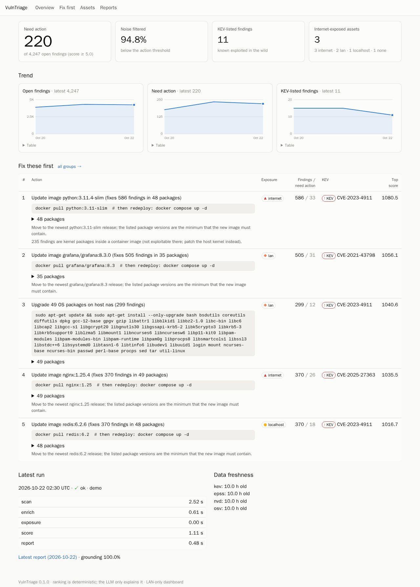
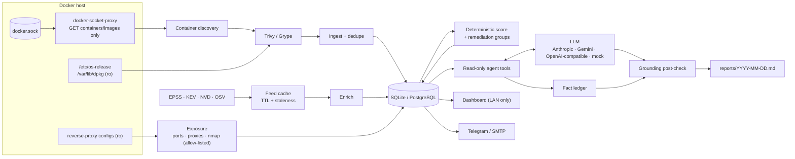

# VulnTriage

**AI-assisted vulnerability triage for a self-hosted Linux homelab.**

Every night VulnTriage scans every running container image and the host. It enriches
each finding with real-world exploit intelligence (CISA KEV, FIRST EPSS, NVD, OSV) and
works out how reachable each service actually is. It then ranks findings by risk instead
of by CVSS alone, and writes a short report: *fix these N things first, here's why,
here's the command.*

An LLM agent writes the explanation. It **never decides the ranking**, and **every fact
it states is checked** against the data it was given.



On the bundled demo homelab (7 old public images plus an Ubuntu host), VulnTriage turns
**4,247 open findings into 220 that need action and 11 concrete commands**. That is
94.8% noise reduction, and all 11 KEV-listed findings land in the top 20, where a
CVSS-only sort puts none of them. Full numbers are in
[docs/EVALUATION.md](docs/EVALUATION.md).

## Contents

- [What it does](#what-it-does)
- [Architecture](#architecture)
- [Quickstart](#quickstart)
- [Configuration](#configuration)
- [Security considerations](#security-considerations)
- [Evaluation](#evaluation)
- [Development](#development)

## What it does

| Stage | What happens |
|---|---|
| **Scan** | Discovers running containers through the Docker API (read-only), scans each image with **Trivy** (and optionally **Grype**), scans host OS packages with `trivy rootfs`, and deduplicates across runs. Each finding keeps `first_seen`/`last_seen`; fixed findings are resolved, and a failed scan never resolves anything. |
| **Enrich** | **KEV** (date added, due date, ransomware use), **EPSS** (score and percentile, batched), **NVD 2.0** (CVSS v3.1, vector, CWE; only for CVEs the scanner didn't cover, rate-limited, optional API key) and **OSV** (missing fix versions). Every feed is cached with a timestamp. If a feed is down, the cache is used and the report states its age. |
| **Exposure** | `internet` / `lan` / `localhost` / `none` per asset, with evidence, from Docker port bindings, **Nginx** (including Nginx Proxy Manager) and **Caddy** configs, **Traefik** labels, and an optional **nmap** scan that can only target allow-listed private CIDRs. |
| **Score** | Deterministic and documented ([docs/SCORING.md](docs/SCORING.md)): KEV tier → EPSS × exposure → fix-available bonus → CVSS tiebreak, with a stored, human-readable breakdown per finding. Findings are grouped into **remediation actions** ("update image grafana/grafana:8.3.0 → fixes 505 findings") and ranked. |
| **Report** | A tool-calling LLM agent (Anthropic, Gemini, any OpenAI-compatible API including Ollama, or a deterministic mock) writes the summary, the "why" for each top action and a "safe to defer" list. A **grounding post-check** verifies every CVE ID, version, package/version/asset pair, EPSS, CVSS, KEV and exposure claim, and strips unsupported ones ([docs/AGENT.md](docs/AGENT.md)). Saved to `reports/YYYY-MM-DD.md`. |
| **Alert** | Telegram and/or email, only for *new* KEV-listed or high-risk internet-exposed findings. Off by default. |
| **Dashboard** | Overview (raw vs. actionable, KEV count, trends), ranked actions, assets, finding detail with score breakdown and intel, and reports. LAN-only by default, with optional basic auth. |

## Architecture



```
vulntriage/
  scanners/   docker_api (read-only Engine API), trivy, grype, ingest (dedupe), service
  intel/      http (retry/backoff/rate limit), feeds (EPSS/KEV/NVD/OSV), cache, enrich
  exposure/   guard (CIDR allow-list), nmap, proxies (nginx/caddy/traefik), analyze
  scoring.py  remediation.py
  llm/        base, anthropic, gemini, openai_compat, mock, factory
  agent/      tools, prompts, runner, grounding, untrusted (injection guard), report
  web/        FastAPI app, Jinja2 templates, static CSS/JS (no CDN)
  pipeline.py scheduler.py alerts.py evaluation.py demo.py cli.py
fixtures/     Trivy/Grype JSON from old public images, intel snapshot, demo homelab
```

## Quickstart

### Try it with no Docker, network or API key

```bash
pip install -e ".[dev]"
vulntriage run --demo          # 3 simulated nightly runs on bundled fixtures
vulntriage serve --demo        # http://127.0.0.1:8080
cat reports/demo/*.md          # the generated reports
```

### Run it on your homelab with Docker Compose

```bash
git clone <this repo> vulntriage && cd vulntriage
cp .env.example .env           # optional: LLM key, proxy config paths, alerts...
docker compose up -d --build   # dashboard on http://127.0.0.1:8080
docker compose exec vulntriage vulntriage run    # first run now instead of waiting for 02:30
```

Out of the box, the stack:

- discovers containers through a **GET-only socket proxy** (`tecnativa/docker-socket-proxy`)
  on an internal network;
- scans host OS packages through read-only mounts of `/etc/os-release` and `/var/lib/dpkg`
  (Debian/Ubuntu hosts);
- runs the pipeline nightly at 02:30 (`SCHEDULE_CRON`);
- uses the **mock** LLM until you set `LLM_PROVIDER` and a key;
- binds the dashboard to **127.0.0.1**. Set `VT_BIND` to a LAN or Tailscale IP to open it
  to other machines on your network.

To make exposure analysis aware of your reverse proxy, mount its configs read-only (see
the comments in `docker-compose.yml`) and set `NGINX_CONFIG_PATHS` / `CADDY_CONFIG_PATHS`
and `INTERNET_HOSTNAME_PATTERNS`.

> If `docker compose up` fails with *"all predefined address pools have been fully
> subnetted"*, your Docker daemon has run out of default subnets. Give the two networks
> explicit subnets in a `docker-compose.override.yml` (`networks.<name>.ipam.config`)
> rather than pruning existing networks.

### Without Docker

Install Trivy (and optionally Grype and nmap), then:

```bash
pip install ".[llm]"
vulntriage scan && vulntriage enrich && vulntriage exposure && vulntriage score && vulntriage report
# or all at once, e.g. from cron:  30 2 * * *  vulntriage run
```

### CLI reference

```
vulntriage scan [--image REF] [--grype]   scan running containers / one image / hosts
vulntriage enrich [--offline]             EPSS, KEV, NVD, OSV (cached)
vulntriage feeds                          cache age and last error per feed
vulntriage exposure                       exposure level per asset, with evidence
vulntriage score                          deterministic scores + remediation groups
vulntriage groups                         ranked "fix this first" actions
vulntriage explain ID                     why a finding scored what it did
vulntriage list-findings [--kev] [--severity HIGH] [--asset NAME]
vulntriage report [--provider P]          LLM report -> reports/YYYY-MM-DD.md
vulntriage run [--demo] [--no-alerts]     the whole nightly pipeline
vulntriage serve [--demo]                 dashboard (+ scheduler if SCHEDULE_ENABLED)
vulntriage scheduler                      scheduler only, foreground
vulntriage eval [--demo]                  write docs/EVALUATION.md
```

## Configuration

Everything comes from environment variables or `.env`. See
[`.env.example`](.env.example) for the full list. No hostname, IP or key is hard-coded.

| Variable | Default | Purpose |
|---|---|---|
| `DATABASE_URL` | `sqlite:///./data/vulntriage.db` | Any SQLAlchemy URL, e.g. `postgresql+psycopg://…` (`pip install ".[postgres]"`). |
| `DATA_DIR` / `REPORTS_DIR` | `./data` / `./reports` | Database, caches and Markdown reports. |
| `DOCKER_HOST` | `unix:///var/run/docker.sock` | `tcp://docker-proxy:2375` in Compose. |
| `ENABLE_GRYPE` | `false` | Run Grype as a second scanner; results are merged. |
| `EXCLUDE_IMAGES` / `OWN_IMAGE_PATTERNS` | – | Globs: images to skip / images you build yourself. |
| `HOST_SCAN_TARGETS` / `FS_SCAN_TARGETS` | – | `name=/path` pairs for `trivy rootfs` / `trivy fs`. |
| `NVD_API_KEY` | – | Raises the NVD limit from 5 to 50 requests per 30 s. |
| `NVD_MODE` | `missing` | `missing` / `always` / `never`. |
| `INTEL_TTL_HOURS` / `NVD_TTL_HOURS` | `24` / `168` | Cache lifetime before refetching. |
| `OFFLINE` | `false` | Never contact feeds; use the cache. |
| `INTERNET_HOSTNAME_PATTERNS` | – | Globs of publicly reachable hostnames, e.g. `*.example.com`. |
| `NGINX_CONFIG_PATHS` / `CADDY_CONFIG_PATHS` | – | `owner=/path` (owner = proxy container name). |
| `HOST_LAN_IPS` | – | The Docker host's LAN IPs (matches `proxy_pass http://<ip>:<port>`). |
| `EXPOSURE_OVERRIDES` / `HOST_EXPOSURE` | – / `lan` | Force levels where the path isn't observable. |
| `NMAP_ENABLED` / `NMAP_TARGETS` | `false` / – | Optional connect scan of literal IPs/CIDRs. |
| `ALLOWED_SCAN_CIDRS` | RFC1918 | Allow-list for nmap; public ranges are rejected at startup. |
| `ACTION_THRESHOLD` | `5.0` | Score at which a finding needs action. |
| `SCORING__*` | see [SCORING.md](docs/SCORING.md) | Weights, e.g. `SCORING__EXPOSURE_LAN=0.5`. |
| `LLM_PROVIDER` / `LLM_MODEL` | `mock` / – | `anthropic`, `gemini`, `openai` (OpenAI-compatible) or `mock`. |
| `ANTHROPIC_API_KEY` / `GEMINI_API_KEY` / `OPENAI_API_KEY` | – | Provider keys. |
| `LLM_BASE_URL` | – | OpenAI-compatible endpoint, e.g. `http://ollama:11434/v1`. |
| `REPORT_TOP_N` | `5` | Actions in the "fix first" section. |
| `DASHBOARD_USER` / `DASHBOARD_PASSWORD` | – | Optional HTTP basic auth (set both). |
| `VT_BIND` / `VT_PORT` | `127.0.0.1` / `8080` | Compose port publishing for the dashboard. |
| `SCHEDULE_ENABLED` / `SCHEDULE_CRON` / `SCHEDULE_TIMEZONE` | `false` (`true` in Compose) / `30 2 * * *` / `UTC` | Nightly run. |
| `TELEGRAM_*` / `SMTP_*` | disabled | Alert channels (see `.env.example`). |
| `ALERT_MIN_SCORE` | `50` | High-risk threshold for internet-exposed alerts. |

## Security considerations

**Docker socket.** Access to the Docker API is root-equivalent on the host, and a `:ro`
bind mount of `docker.sock` does **not** make the API read-only. (`:ro` only stops the
socket *file* being replaced; anyone who can connect can still create privileged
containers.) So the VulnTriage container never gets the socket. Compose runs
`docker-socket-proxy`, which holds the socket, allows only `GET` on containers and images
(`POST=0`; networks, secrets, exec and so on are refused), and listens only on an
internal network with no published ports. VulnTriage itself runs as an unprivileged user
with all capabilities dropped and `no-new-privileges`. The remaining trade-off: image
*read* access lets the scanner export image contents, which may include secrets baked
into images. Keep the dashboard and the database private for that reason.

**Scan scope.** nmap is off by default. When enabled, every target goes through a guard
that accepts only literal IPs/CIDRs (no hostnames, so DNS can't redirect a scan) inside
`ALLOWED_SCAN_CIDRS`. The allow-list itself must be non-public space (RFC1918, CGNAT /
Tailscale, ULA); a public CIDR stops the app at startup. Every refused target is logged
and recorded on the run. Scans use `-sT` (connect scan), so no raw sockets or root are
needed. VulnTriage never scans external IPs.

**Dashboard.** It is read-only (no state-changing endpoints), has no external
scripts/fonts/CDNs, sends a strict Content-Security-Policy, renders report Markdown with
raw HTML disabled (LLM text can't inject markup), and supports constant-time basic auth.
It is meant for the LAN or a tailnet. Do not port-forward it or put it behind a public
tunnel. If you need remote access, use a VPN such as Tailscale.

**LLM and prompt injection.** Advisory text (CVE descriptions, titles) is third-party
input. It is sanitised, truncated, wrapped in explicit untrusted-data markers, scanned
for injection phrasing, and excluded from the grounding ledger. The agent's tools are
read-only database queries, so the worst a successful injection could do is change
wording, and the grounding check removes any unsupported facts. When a cloud LLM
provider is configured, finding data (image names, package versions, CVE IDs, exposure
evidence such as hostnames) is sent to that provider. Use `LLM_PROVIDER=mock` or a local
OpenAI-compatible model (Ollama) to keep everything on-premises.

**Secrets and data.** Keys, tokens and passwords live only in `.env` (git-ignored) and
are held as `SecretStr` so they never appear in logs or `repr`. The Telegram token is
never logged, even on errors. `data/` and `reports/` contain your network inventory and
are git-ignored. The repository ships only fixture data from scanning *public* images,
with fictional names and IPs.

**Supply chain.** Trivy and Grype are pinned and verified against their release
checksums in the Dockerfile. GitHub Actions are pinned to commit SHAs.

## Evaluation

`vulntriage eval --demo` regenerates [docs/EVALUATION.md](docs/EVALUATION.md) from the
bundled dataset; `vulntriage eval` measures your own homelab.

| Metric (demo dataset) | Value |
|---|---:|
| Open findings → need action → remediation actions | 4,247 → 220 → 11 |
| Noise reduction | 94.8% |
| KEV recall@10 / @20, VulnTriage | 90.9% / 100% (10 is the most that fit in a top 10) |
| KEV recall@20, CVSS-only / EPSS-only baselines | 0% / 0% |
| Median rank of KEV findings: VulnTriage / KEV-ablated / CVSS-only / EPSS-only | 6 / 50 / 479 / 89 |
| Grounding rate of agent output (3 reports, mock agent) | 100%. A hallucination self-test is caught: 4 fabricated claims removed. |

The ablated ranking matters most here. VulnTriage uses KEV as an input, so its own KEV
recall is high by construction. Without KEV, EPSS × exposure still lifts exploited bugs
about 10× closer to the top than CVSS does, but it does not put them first. That is why
KEV is a hard tier, not a weight. The demo's 100% grounding comes from the deterministic
mock agent; a real model's rate is measured the same way on your own reports.

## Development

```bash
make install     # pip install -e ".[dev]"
make check       # ruff + ruff format --check + mypy --strict + pytest
make demo        # run the demo pipeline and serve it
make eval        # regenerate docs/EVALUATION.md
```

- Tests never touch the network: HTTP is mocked with `respx`/`httpx.MockTransport`, a
  socket guard fails any real connection, and scanners replay stored JSON.
- Fixtures come from scanning old public images (`scripts/build_fixtures.py`) and a
  public intel snapshot (`scripts/fetch_intel_fixtures.py`).
- CI (`.github/workflows/ci.yml`) runs lint, type-check and tests on Python 3.11 and
  3.12, the demo end to end, and a Docker build plus smoke test.

## License

[MIT](LICENSE)
